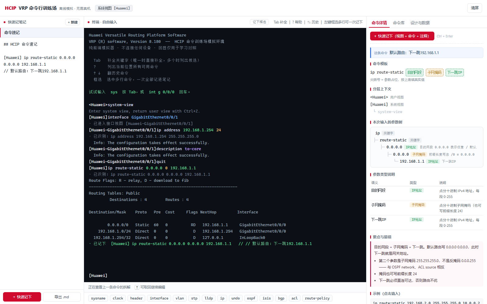
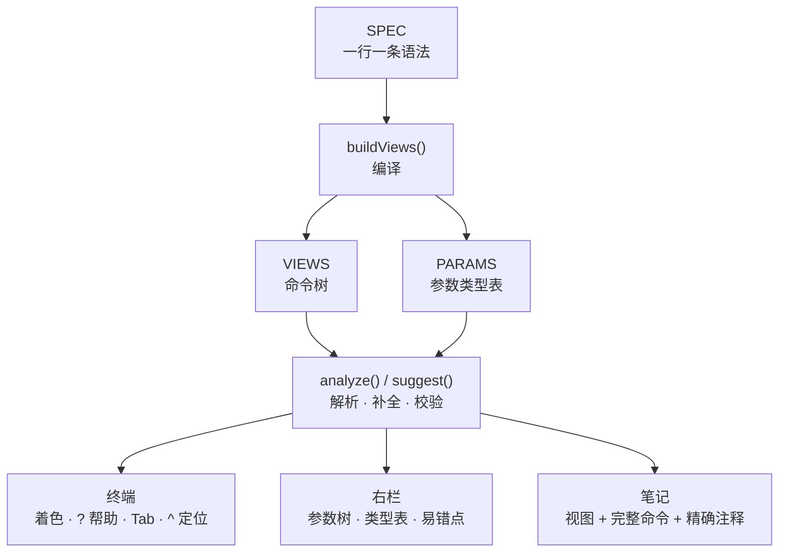

# HCIP VRP 命令行训练场

**567 条命令 · 33 个视图 · 87 条断言全绿 · 185 KB 单文件 · 零依赖**

一个纯前端的华为 **HCIP-Datacom** 学习工具：eNSP 风格的命令行输入体验 + 快速记笔记。
单文件、零依赖、不联网、不需要真机或 eNSP，双击 `index.html` 就能用。



> 终端练命令，左边记笔记，右边实时拆解每个参数的类型和语义。

---

## 目录

- [这是什么](#这是什么)
- [界面](#界面)
- [功能](#功能)
  - [终端](#1-终端)
  - [参数类型标注](#2-参数类型标注)
  - [掩码与反掩码](#3-掩码与反掩码)
  - [快速笔记](#4-快速笔记)
  - [命令库与详情](#5-命令库与详情)
- [快速开始](#快速开始)
- [快捷键](#快捷键)
- [命令库](#命令库)
- [数据组织](#数据组织)
- [自测脚本](#自测脚本)
- [边界与取舍](#边界与取舍)
- [后续计划](#后续计划)
- [说明](#说明)

---

## 这是什么

备考 HCIP-Datacom 时，命令记不住、参数填错位置、反掩码和子网掩码搞混，是很常见的问题。这个工具只做三件事：

1. **让你像在 eNSP 里一样敲命令**：Tab 补全、`?` 帮助、视图跳转、缩写识别、错误定位。
2. **把每条命令拆开给你看**：哪个词是关键字，哪个位置要填接口名、IP、掩码还是反掩码。
3. **让你把命令连同注释一键记走**：笔记是纯 Markdown，可以导出。

它**不是模拟器**：不回显真实设备的协议交互，也不打包任何华为固件。所有输出都是为学习场景写的本地模拟。

---

## 界面

三栏布局：

| 区域 | 作用 |
|---|---|
| **左栏 · 笔记** | 多条笔记自由编辑，`＋ 快速记下` / `记下框选` / 导出 `.md` |
| **中栏 · 终端** | 命令行输入，Tab 补全、`?` 帮助、历史、视图切换、错误 `^` 定位 |
| **右栏 · 命令详情** | 这条命令在做什么、分层上下文、参数树、参数类型表、要点与易错 |

右栏还有两个标签页：

- **命令库**：567 条命令按视图分组，支持搜索，点一条直接填入终端
- **设计与数据**：数据组织方式、为什么这么设计、扩容路径

---

## 功能

### 1. 终端

| 能力 | 说明 |
|---|---|
| **Tab 补全** | 只补当前这个词：唯一候选直接补全；多候选先补公共前缀；没有公共前缀时**原位逐个切换**，不会一路把整条命令填完 |
| **`?` 帮助** | 任何位置都能按，先回显当前输入 + `?`，再列候选；参数位会告诉你这里该填什么类型 |
| **历史命令** | `↑` / `↓` 翻之前执行过的命令 |
| **视图跳转** | `system-view`、`interface`、`vlan`、`ospf`、`bgp`、`acl`、`ip pool` 等会真正进入对应视图，提示符随之变化 |
| **跨视图命令** | `interface` / `vlan` 在任意视图都能直接用；`q` / `quit` 逐级返回，`return` 直接回用户视图 |
| **缩写识别** | `int g 0/0/1` → `interface GigabitEthernet0/0/1`；`ip rou` → `ip route-static`；有歧义时列出所有候选（`i` → interface / ip / isis / info-center / ipv6） |
| **错误定位** | 报错用 VRP 原话：`Unrecognized` / `Ambiguous` / `Wrong parameter` / `Too many parameters`，`^` 精确指到出错的那个词，下一行给中文解释 |
| **大小写** | 命令不区分大小写，`SYSNAME AR1` 和 `sysname AR1` 等价 |

### 2. 参数类型标注

每个参数位都带类型和语义，颜色区分：

| 类型 | 颜色 | 示例 | 说明 |
|---|---|---|---|
| 关键字 | 白色 | `ip` `address` | 命令树的边 |
| 接口名 | 青色 | `GigabitEthernet0/0/1` | 支持全称和简写，自动规范化 |
| IP 地址 | 蓝色 | `192.168.1.1` | 点分十进制，逐段校验 0–255 |
| 子网掩码 | 橙色 | `255.255.255.0` | 也可以写前缀长度 `24` |
| 反掩码 | 紫色 | `0.0.0.255` | OSPF `network`、ACL `source` 等位置 |
| 枚举 / 数值 | 绿色 | `permit` `4096` | 有取值范围或固定取值 |

右侧「本次输入的参数树」会逐行标注，例如：

```text
[Huawei-GigabitEthernet0/0/1] ip address 192.168.1.254 255.255.255.0
                                  └ 接口IP地址        └ 子网掩码
```

### 3. 掩码与反掩码

`mask` 和 `wildcard` 是**两个独立类型**，不是同一个「IP 地址」：

```text
[Huawei-GigabitEthernet0/0/1] ip address 192.168.1.1 0.0.0.255
                                               ^
Error: Wrong parameter found at '^' position.
  ↳ 此处需要子网掩码，0.0.0.255 是反掩码；把每一位取反：0.0.0.255 → 255.255.255.0
```

反方向也会纠正：

```text
[Huawei-ospf-1-area-0] network 192.168.1.0 255.255.255.0
                                           ^
  ↳ 此处需要反掩码，应写成 0.0.0.255
```

### 4. 快速笔记

三种记法：

| 方式 | 操作 |
|---|---|
| 记当前一条 | 点左栏 `＋ 快速记下`，或按 `Ctrl + Enter`（光标不在终端也生效） |
| **框选多条** | 在终端里**按住左键拖过多行**，松手后点浮出的「＋ 记下选中的 N 条命令」，或点终端标题栏的「记下框选 (N)」 |
| 记框选（键盘） | `Ctrl + Shift + Enter` |

写入格式只有两行，干净、可读：

```text
[Huawei-GigabitEthernet0/0/1] ip address 192.168.1.254 255.255.255.0
// 给接口配IP地址192.168.1.254/24（掩码 255.255.255.0）

[Huawei] ip route-static 0.0.0.0 0.0.0.0 192.168.1.1
// 默认路由：下一跳192.168.1.1
```

说明：

- 注释是**按实参生成**的，不是套模板：`interface LoopBack0` → 「进入环回接口0的配置视图」，`vlan batch 10 20 30` → 「批量创建VLAN 10 20 30（共3个）」
- 笔记里落的是**完整命令**：缩写会被还原，`24` 会补成 `255.255.255.0`
- 框选时只认命令行，路由表、`Info:`、`· 已识别` 这类输出自动跳过
- 当时没通过校验的命令也会记下来，注释标 `✗ 当时未通过校验：…`，方便回看踩过的坑
- 笔记存在浏览器 `localStorage`（键名 `hcip-notes-v1`），可以随时导出 `.md`

### 5. 命令库与详情

**命令库**按视图分组，顶部显示总数，支持按命令、说明、视图名搜索，点一条直接填进终端。

**右侧详情**会随输入实时变化：

- **这条命令**：用实参拼出来的一句话解释
- **命令模板**：`ip add ⟨接口IP地址⟩ ⟨子网掩码⟩`
- **分层上下文**：用户视图 → 系统视图 → 接口视图 整条链
- **本次输入的参数树**：逐段着色，带类型和备注
- **参数类型说明**：语义、类型、说明、示例四列
- **要点与易错**：这条命令的注意事项

---

## 快速开始

1. 下载或克隆本仓库
2. 双击 `index.html`（或拖进浏览器）
3. 在终端里敲 `system-view` 回车，再试 `int g 0/0/0`

不需要 Node、不需要构建、不需要起服务器。推荐 Chrome / Edge 最新版。

```bash
git clone https://github.com/agnay8/hcip-lab.git
cd hcip-lab
# 直接打开 index.html
```

---

## 快捷键

| 按键 | 作用 |
|---|---|
| `Tab` | 补全当前词（多候选时继续按可逐个切换） |
| `?` 或 `Shift + /` | 查看当前位置的可用命令 / 参数说明 |
| `↑` `↓` | 翻历史命令 |
| `Enter` | 执行命令 |
| `Ctrl + Enter` | 记下当前命令到笔记 |
| `Ctrl + Shift + Enter` | 记下终端里框选的多条命令 |
| `Ctrl + L` | 清屏（光标在终端输入框时） |

---

## 命令库

**567 条命令 / 33 个视图**，覆盖 HCIP-Datacom 考纲的 62 个考点。

<details>
<summary>展开 33 个视图</summary>

用户视图、系统视图、接口视图、Eth-Trunk 视图、VLAN 视图、OSPF 视图、OSPF 区域视图、IS-IS 视图、BGP 视图、BGP IPv4 地址族、ACL 视图、地址池视图、AAA 视图、VTY 视图、MPLS 视图、PIM 视图、Route-Policy 视图、MST 域视图、OSPFv3 视图、BGP IPv6 地址族、RIP 视图、策略路由视图、流分类视图、流行为视图、流策略视图、Smart Link 视图、RRPP 域视图、RADIUS 模板视图、VPN 实例视图、BGP VPNv4 地址族、MPLS LDP 视图、MSDP 视图、DHCPv6 地址池视图

</details>

覆盖面包括：VLAN / Trunk / Hybrid、STP / RSTP / MSTP、静态路由、OSPF / OSPFv3、IS-IS、BGP（含联盟、反射、聚合）、路由策略（ip-prefix / route-policy / filter-policy）、ACL、NAT、DHCP / DHCPv6、VRRP、BFD、MPLS / LDP / VPN、组播（PIM / IGMP Snooping / MSDP）、QoS、端口安全、DHCP Snooping、IPSG、uRPF、Smart Link / RRPP、堆叠、文件系统等。

### 新增一条命令

命令库是「一行一条语法」的编译式写法，加命令只需要加一行：

```js
{ v:'if', c:'ip address <ipv4:接口IP地址> <mask:子网掩码>', out:'ok', d:'配置接口 IP 地址' }
```

| 字段 | 含义 |
|---|---|
| `v` | 所属视图，如 `if` / `system` / `ospf` |
| `c` | 语法，`<类型:语义>` 是参数位，`<enum{a,b}:语义>` 是枚举 |
| `to` | 执行后进入哪个视图 |
| `out` | 回显用哪段模拟输出 |
| `d` | 这条命令的说明 |
| `rep` | 该参数可以重复出现（如 `vlan batch 10 20 30`） |

启动时 `buildViews()` 会把 SPEC 编译成命令树：同前缀合并、按类型绑定校验器、按语义自动开启主机位提示。

---

## 数据组织



四个数据集：

1. **VIEWS 命令树**：每个视图一棵树，关键字是边，参数是带类型的叶子。只有树结构才能同时做到「按前缀补全 + 按位置校验 + 按层级渲染」。
2. **PARAMS 参数类型表**：类型 ↔ 校验器 ↔ 标签。类型是「形」（怎么校验），`role` 是「义」（这一位是什么）。
3. **info 释义**：挂在命令末节点上，随解析结果自动带出，避免「命令改了文档没改」。
4. **notes 笔记**：`{id, title, body}`，纯文本 / Markdown，存 `localStorage`。

解析引擎是纯函数、不依赖 DOM，可以直接在 Node 里跑单测。

---

## 自测脚本

仓库里带了三个验收脚本，改完命令库跑一遍就知道有没有写坏：

```bash
node test.js    # 引擎断言：解析、补全、纠错、视图跳转（87 条）
node exam.js    # HCIP-Datacom 考纲对照（62 个考点，逐条实际解析）
node audit.js   # 27 个功能域覆盖体检
```

输出示例：

```text
结果: 87 passed, 0 failed

命令库：567 条 / 33 个视图
考点覆盖：62/62 （100%）

OSPF          ████████████  12/12
BGP           ████████  8/8
MPLS / VPN    █████  5/5
...
```

---

## 边界与取舍

- **不是 eNSP 全量命令**：完整 VRP 手册约 5000+ 条，还分 AR / S 系列和版本差异。这里优先保证考纲和常用排错命令的语法正确，不硬凑数量。
- **不回显真实协议行为**：路由表、邻居状态、`display` 输出都是写好的示例文本，用来理解命令用途，不能当排错依据。
- **不做设备连接**：不打包固件、不启动虚拟机。想连真机可以自己 `telnet`，本项目只当输入和笔记工具。
- **数据只在本机**：笔记存浏览器，换设备需要自己导出 `.md`。

## 后续计划

- 继续按考纲补命令，优先补 DHCPv6 / ND / OSPFv3 的细节
- 支持导入设备 `?` 输出或命令手册，批量生成 SPEC
- 笔记增加 Markdown 预览和搜索
- 可选的「连 eNSP」模式：只做终端前端，回显来自真实设备

## 说明

- 本项目仅用于学习和复习，命令语法参考华为公开文档。
- 华为、eNSP、VRP 是华为技术有限公司的商标，本项目与华为无关。
- 欢迎提 Issue 指出命令语法错误，最好附上设备型号和 VRP 版本。
